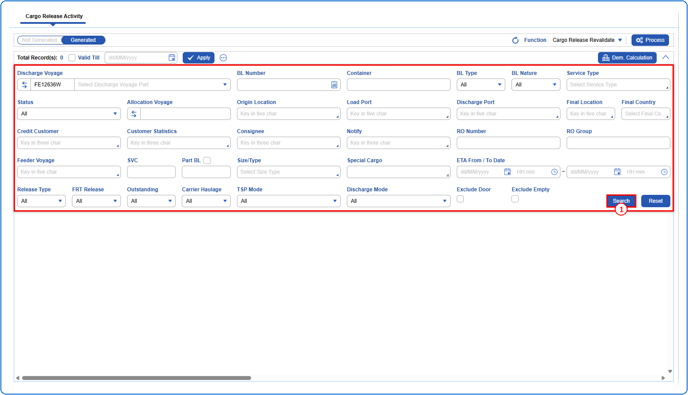
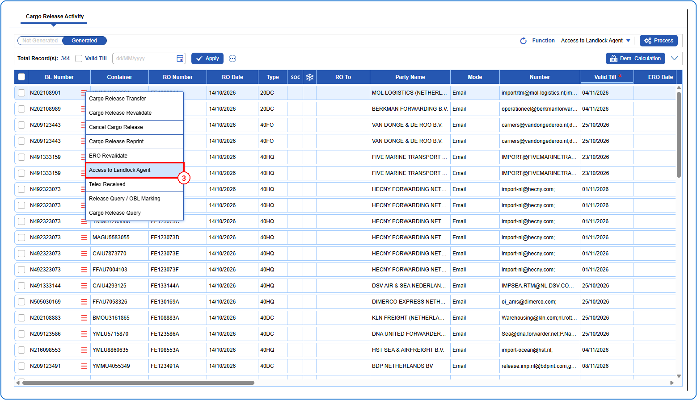
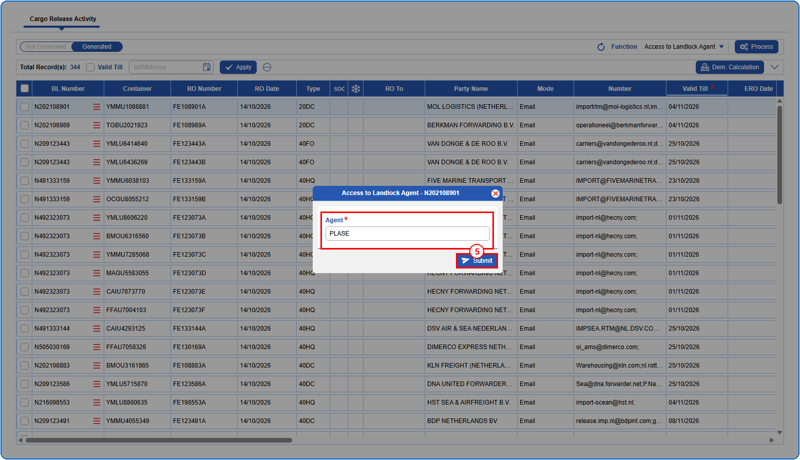
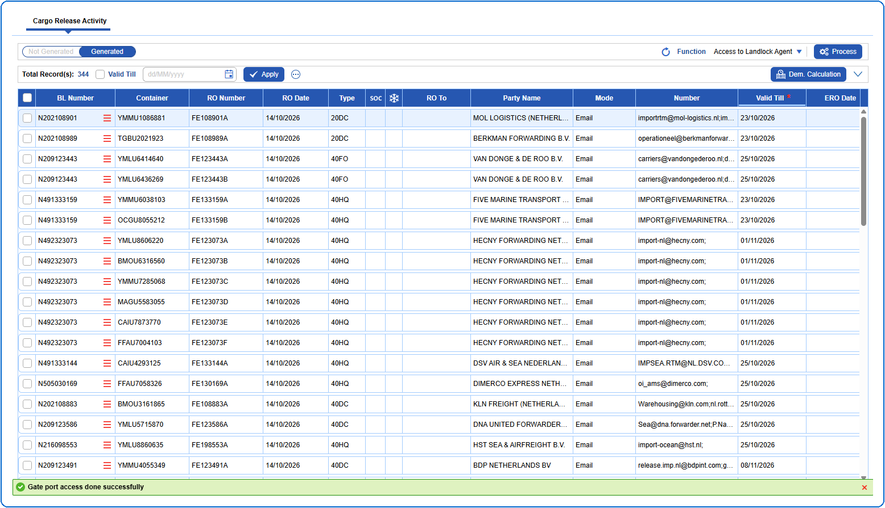

## Steps
**Step 1** : Enter the query fields with desirable input for querying data and click on {img:../img/crq_btn_search.png}.

**Step 2** : Upon clicking {img:../img/crq_btn_search.png}, BLs with matching information are returned.
**Step 3** : The user should drag the cursor to the record menu icon {icon:record_menu} in the respective record, click on it, and then select "**Access to Landlock Agent**" from the menu.

**Step 4** : Upon clicking "**Access to Landlock Agent**" the user is shown Access to Landlock Agent pop up screen.
**Step 5** : Enter the data in **Agent** field and click on {img:../img/landlock_btn_submit.png}. This field is mandatory.

If successfully submitted, a success message is shown as given below.

