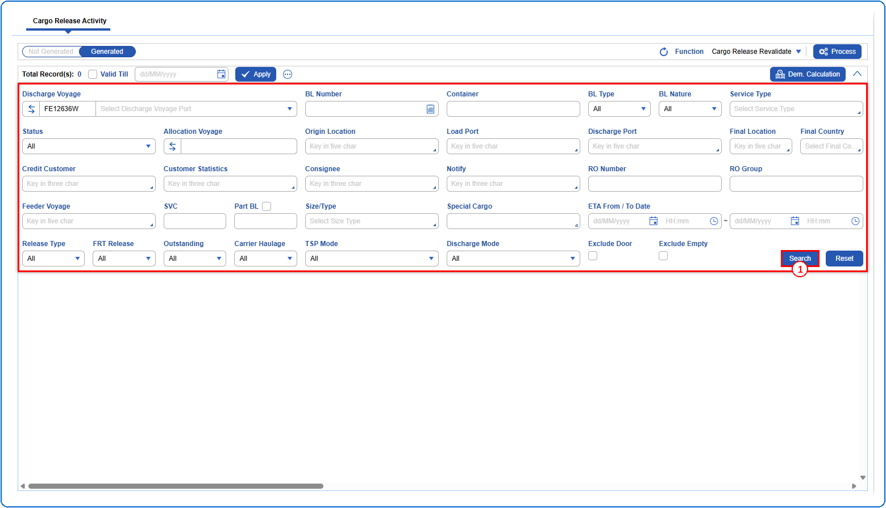
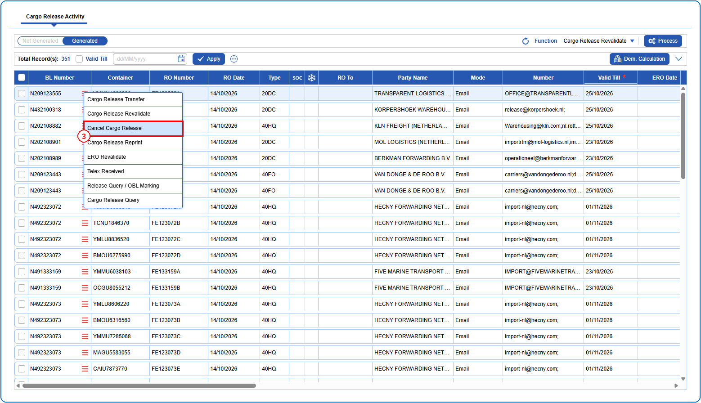
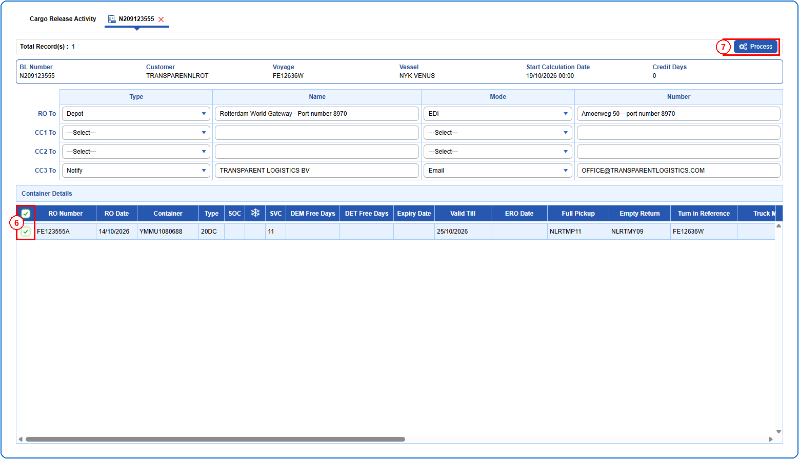
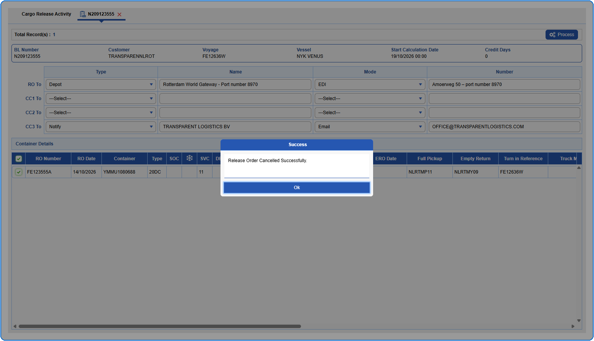

## Steps
**Step 1** : Enter the query fields with desirable input for querying data and click on {img:../img/crq_btn_search.png}.

**Step 2** : Upon clicking {img:../img/crq_btn_search.png}, BLs with matching information are returned.
**Step 3** : The user should drag the cursor to the record menu icon {icon:record_menu} in the respective record, click on it, and then select "**Cancel Cargo Release**" from the menu.

**Step 4** : Upon clicking "**Cancel Cargo Release**", User will be shown the Cancel Cargo Release screen.
**Step 5** : Either select all containers available by clicking on {img:../img/cancel_cb_all.png}(select all checkbox) or select individual containers by clicking on {img:../img/cancel_cb_single.png}(single select checkbox).
**Step 6** : Click on {img:../img/cancel_btn_process.png}.

If successfully processed, an alert is shown as given below.

