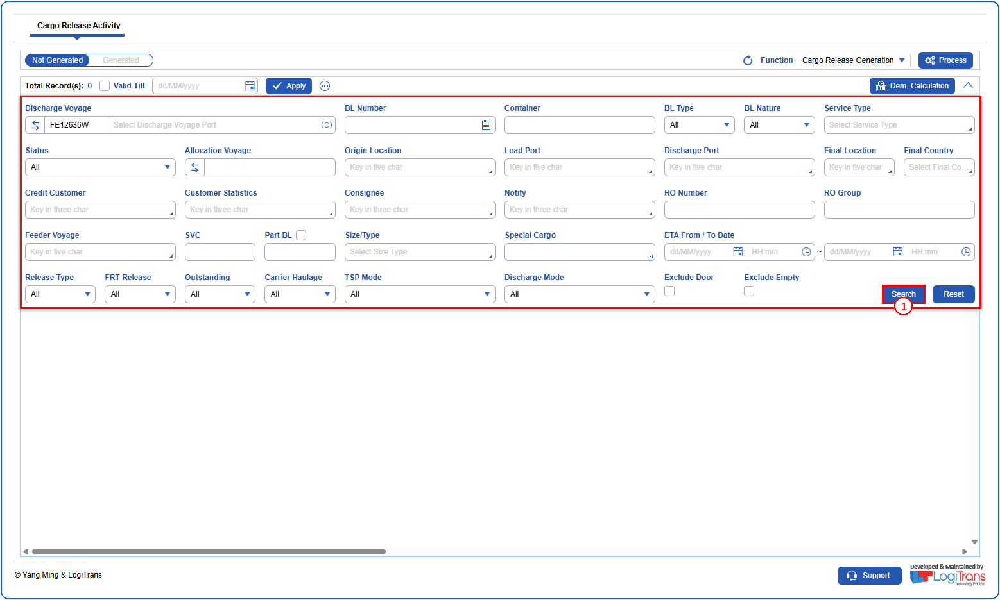
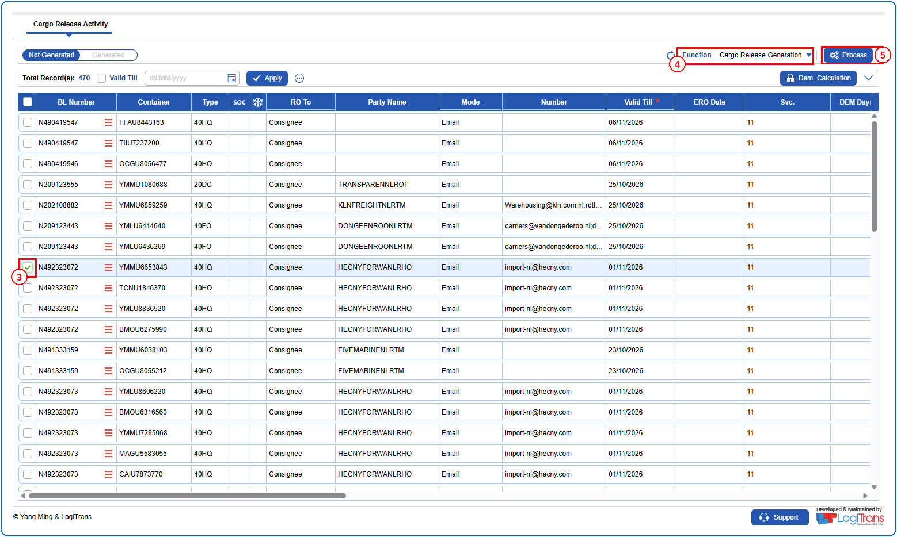
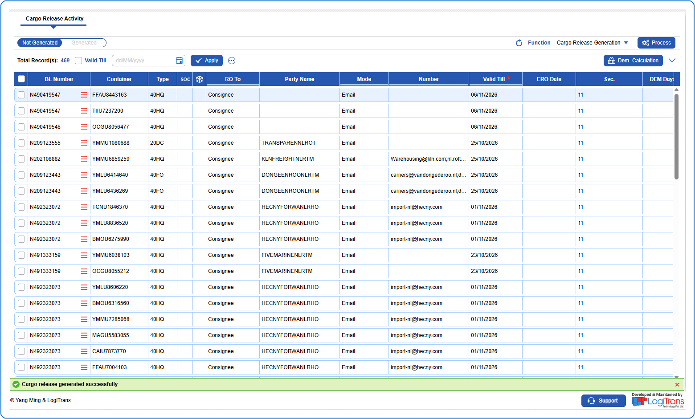

## Steps
**Step 1** : Enter the query fields with desirable input for querying data and click on {img:../img/btn_search.png}.

**Step 2** : Upon clicking {img:../img/btn_search.png}, BLs with matching information are returned.
**Step 3** : Either select all BLs available by clicking on {img:../img/cb_select_all.png}(select all checkbox) or select individual BLs by clicking on {img:../img/cb_single_select.png}(single select checkbox).
**Step 4** : Select "**Cargo Release Generation**" from the **Function** drop-down.
**Step 5** : Click on {img:../img/btn_process.png}.

If successfully processed, a success message is shown as given below, the processed record is moved from "**Not Generated**" to "**Generated**" and the "**Total Record(s)**" count is reduced from "**470**" to "**469**".

