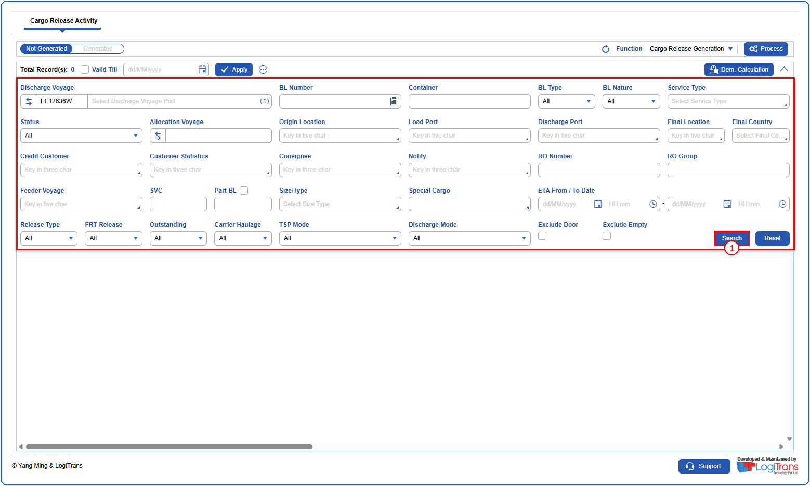
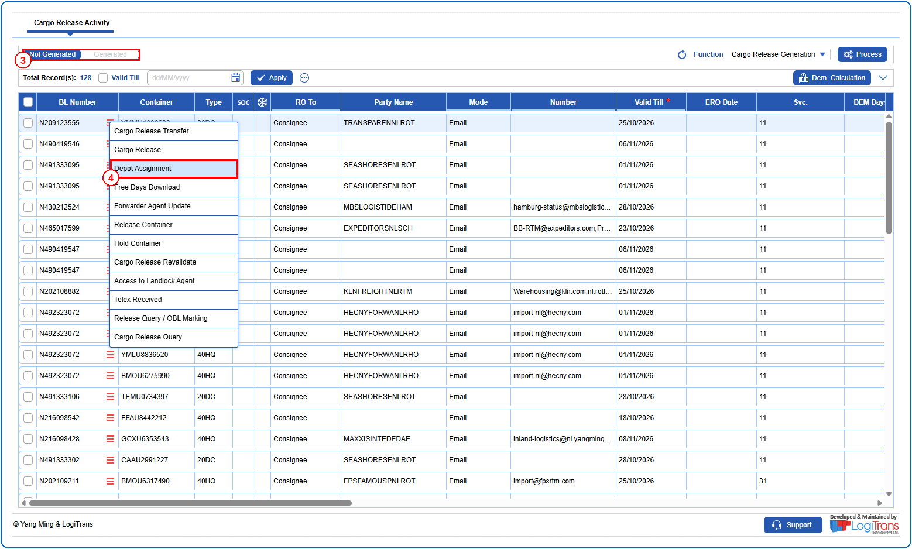
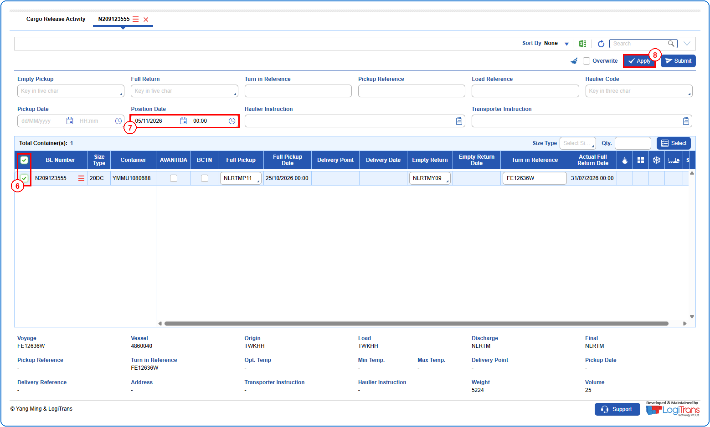
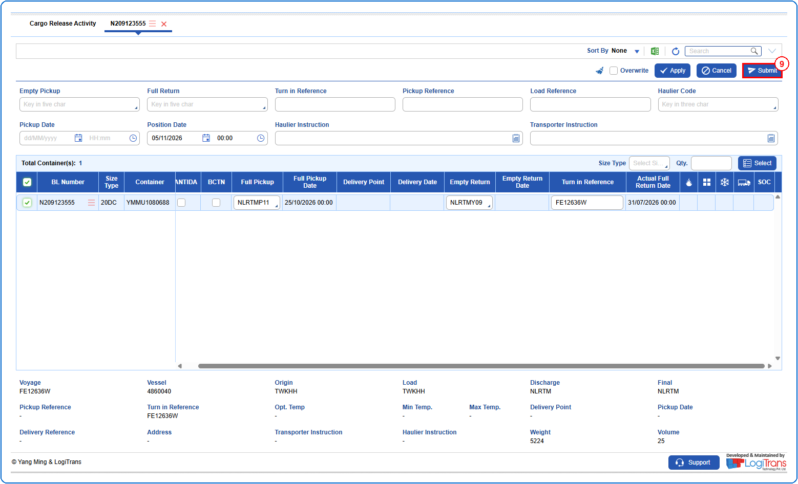
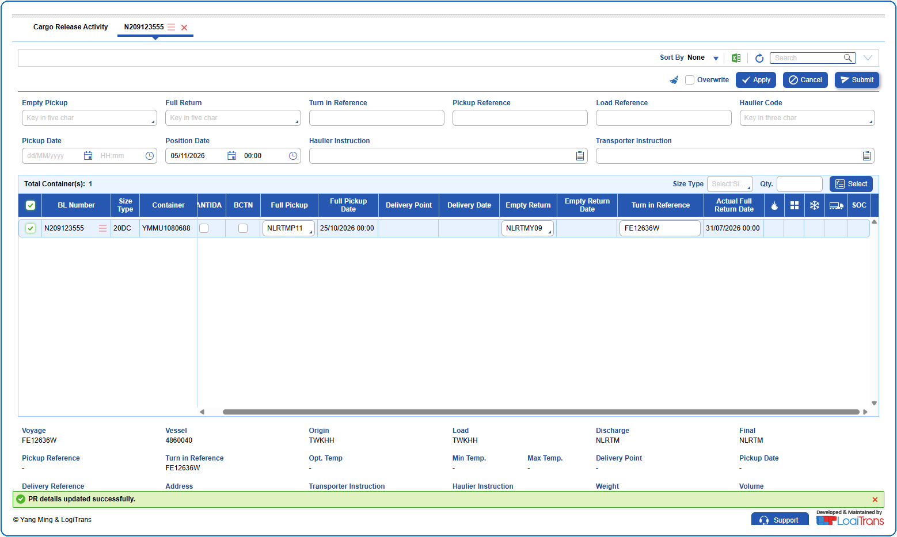

## Steps
**Step 1** : Enter the query fields with desirable input for querying data and click on {img:../img/btn_search.png}.

**Step 2** : Upon clicking {img:../img/btn_search.png}, BLs with matching information are returned.
**Step 3** : Click on "**Not Generated**" in the toggle to view the BLs that do not have existing Release Orders.
**Step 4** : The user should drag the cursor to the record menu icon {icon:record_menu} in the respective record, click on it, and then select "**Depot Assignment**" from the menu.

**Step 5** : Upon clicking "**Depot Assignment**" the user is shown Depot Assignment screen with the BL from which the menu was accessed.
**Step 6** : Either select all containers available by clicking on {img:../img/dpa_cb_all.png}(select all checkbox) or select individual containers by clicking on {img:../img/dpa_cb_single.png}(single select checkbox).
**Step 7** : Enter the data in **Position Date** field.
**Step 8** : Click on {img:../img/dpa_btn_apply.png} to apply the entered data to the selected containers.

**Step 9** : Click on {img:../img/dpa_btn_submit.png}.

If successfully submitted, a success message is shown as given below.

