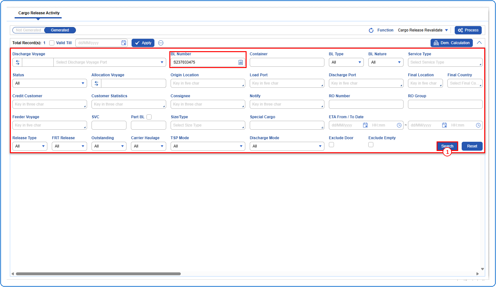
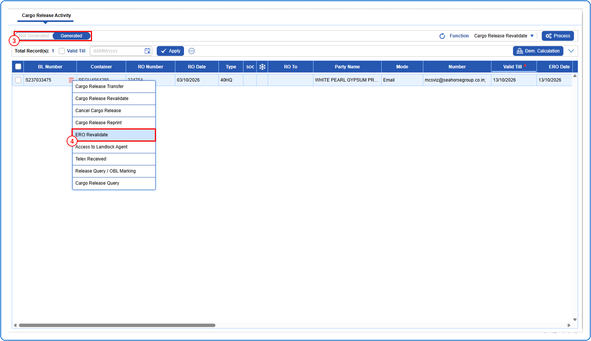
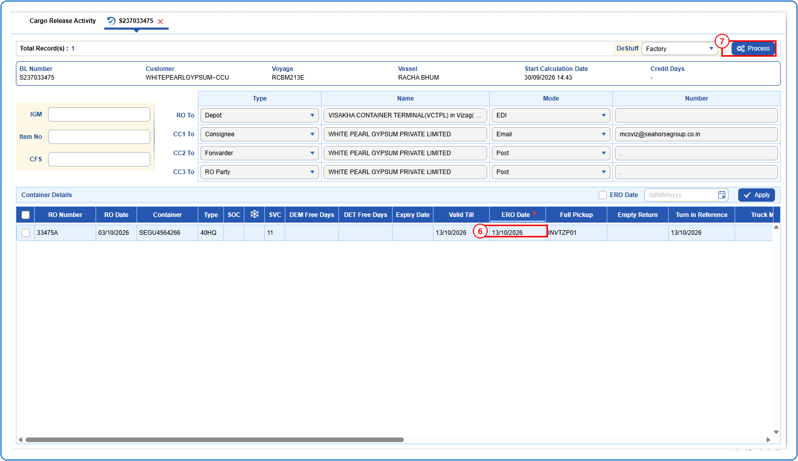
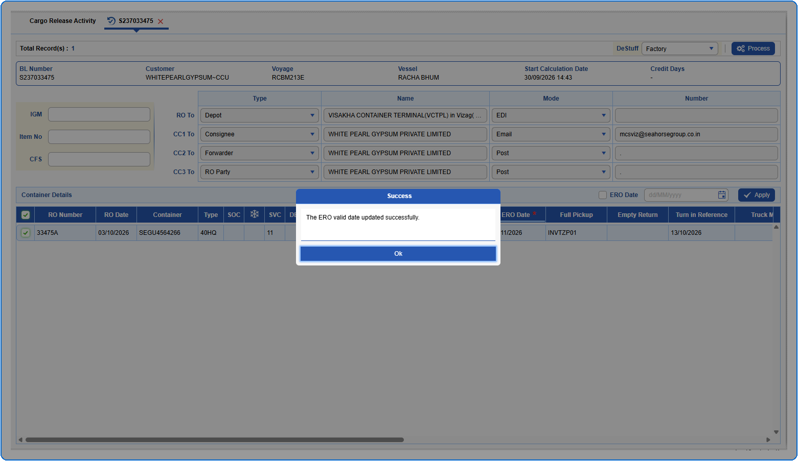

## Steps
**Step 1** : Enter the query fields with desirable input for querying data and click on {img:../img/btn_search.png}.

**Step 2** : Upon clicking {img:../img/btn_search.png}, BLs with matching information are returned.
**Step 3** : Click on "**Generated**" in the toggle to view the BLs that have existing Release Orders.
**Step 4** : The user should drag the cursor to the record menu icon {icon:record_menu} in the respective record, click on it, and then select "**ERO Revalidate**" from the menu.

**Step 5** : Upon clicking "**ERO Revalidate**" the user is shown ERO Revalidate screen.
**Step 6** : Enter the new ERO Date under the **ERO Date** column.
**Step 7** : Click on {img:../img/btn_process.png}.
**Note:** You can also change the ERO Date using the **ERO Date** field, click on {img:../img/btn_apply.png} and process the changed date to the selected row.
>> {img:../img/ero_note_strip.png}

If successfully processed, an alert is shown as given below.

