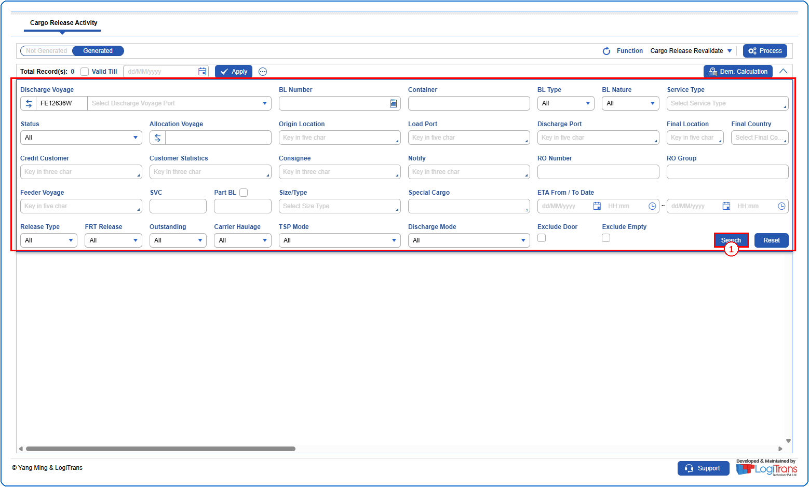
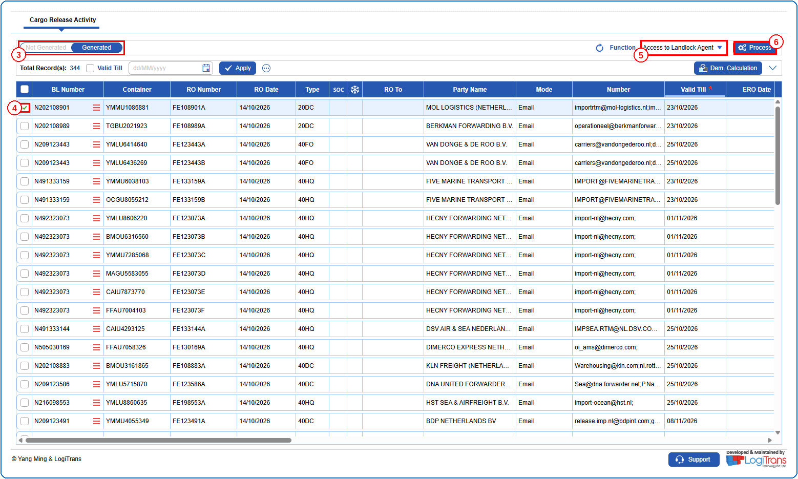
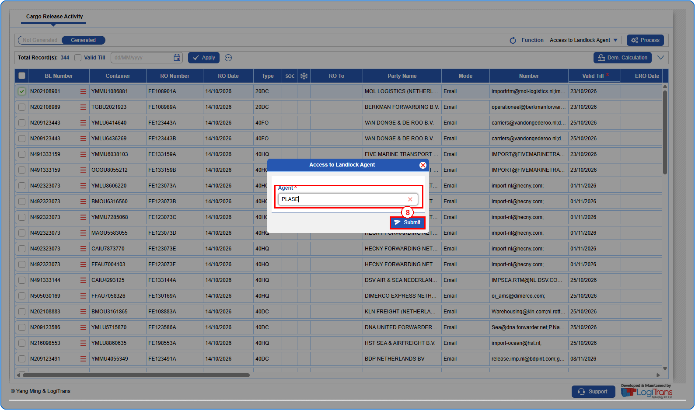
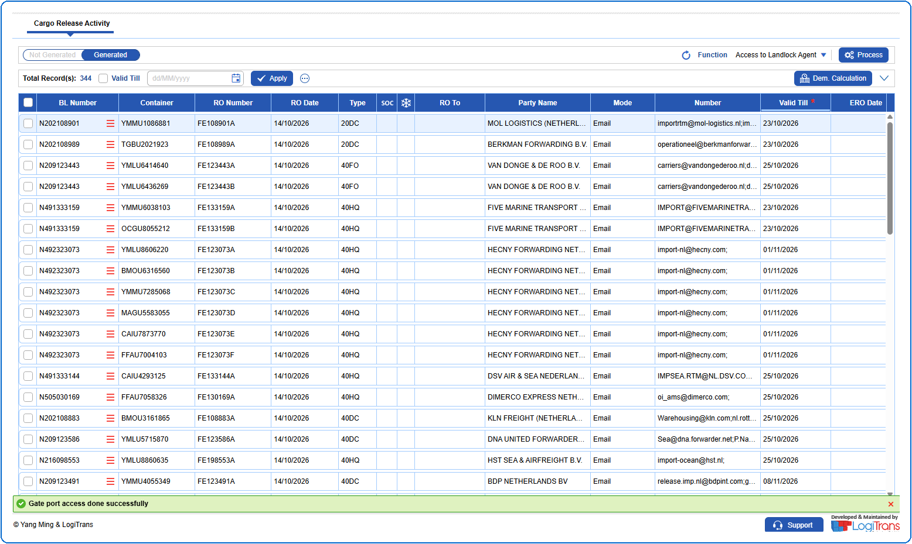

## Steps
**Step 1** : Enter the query fields with desirable input for querying data and click on {img:../img/btn_search.png}.

**Step 2** : Upon clicking {img:../img/btn_search.png}, BLs with matching information are returned.
**Step 3** : Click on "**Generated**" in the toggle to view the BLs that have existing Release Orders.
**Step 4** : Either select all containers available by clicking on {img:../img/cb_select_all.png}(select all checkbox) or select individual containers by clicking on {img:../img/cb_single_select.png}(single select checkbox).
**Step 5** : Select "**Access to Landlock Agent**" in the **Function** dropdown.
**Step 6** : Click on {img:../img/gll_btn_process.png}.

**Step 7** : Upon clicking {img:../img/gll_btn_process.png}, the user is shown Access to Landlock Agent pop up screen.
**Step 8** : Select the **Agent** from the dropdown and click on {img:../img/gll_btn_submit.png}.

If successfully processed, a success message is shown as given below.

