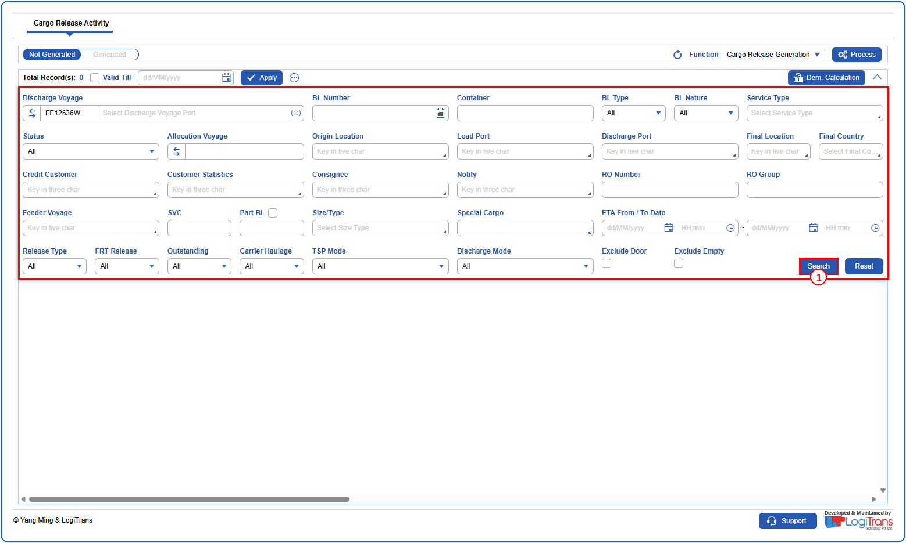
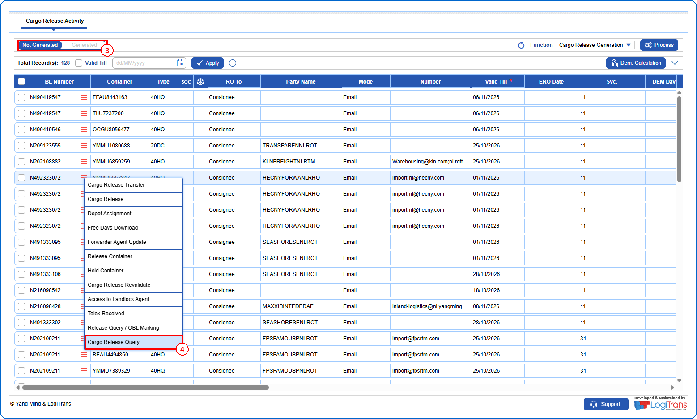
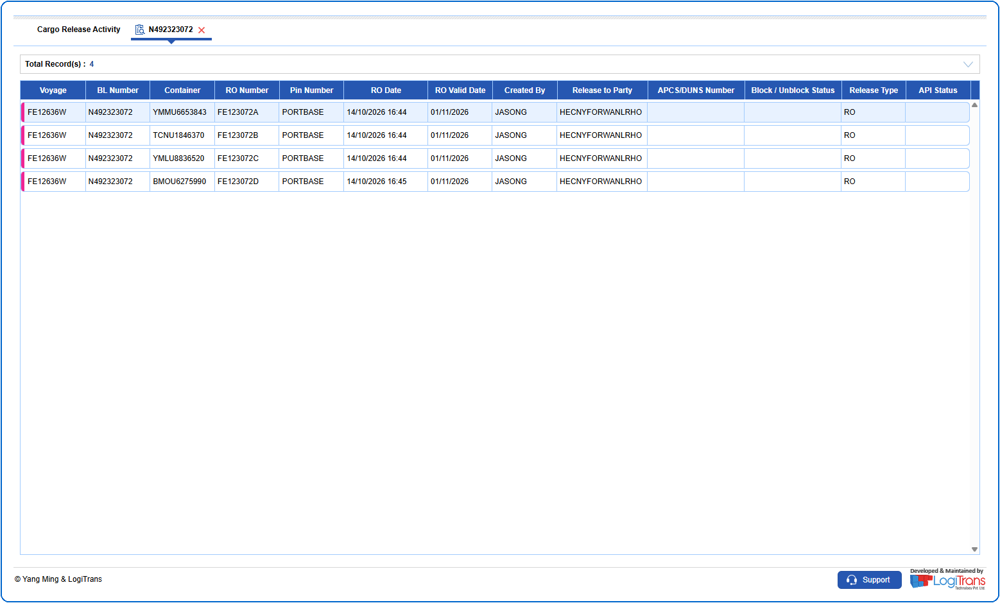

## Steps
**Step 1** : Enter the query fields with desirable input for querying data and click on {img:../img/btn_search.png}.

**Step 2** : Upon clicking {img:../img/btn_search.png}, BLs with matching information are returned.
**Step 3** : Click on "**Not Generated**" in the toggle to view the BLs that do not have existing Release Orders.
**Step 4** : The user should drag the cursor to the record menu icon {icon:record_menu} in the respective record, click on it, and then select "**Cargo Release Query**" from the menu.

**Step 5** : Upon clicking "**Cargo Release Query**", User will be shown the Cargo Release Query screen with the Release Order details of the respective BL as shown below.

