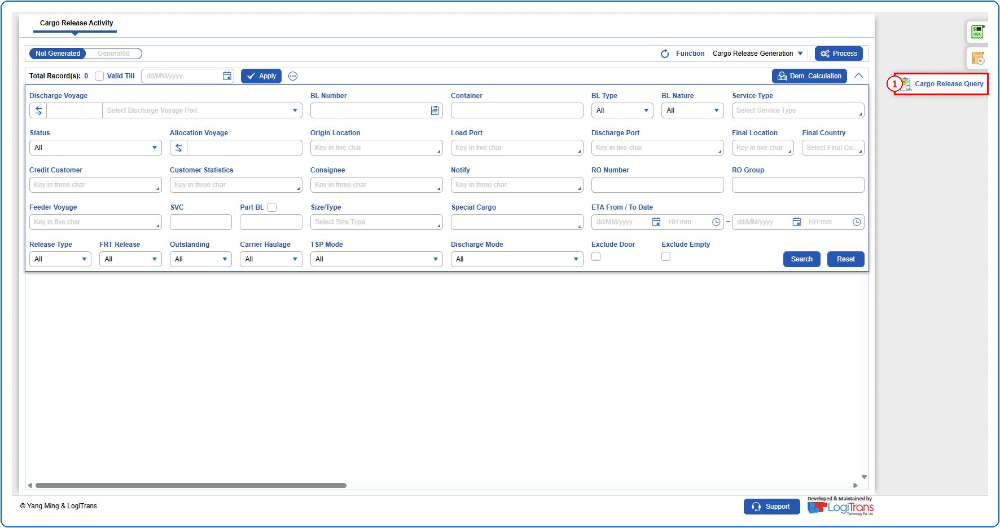
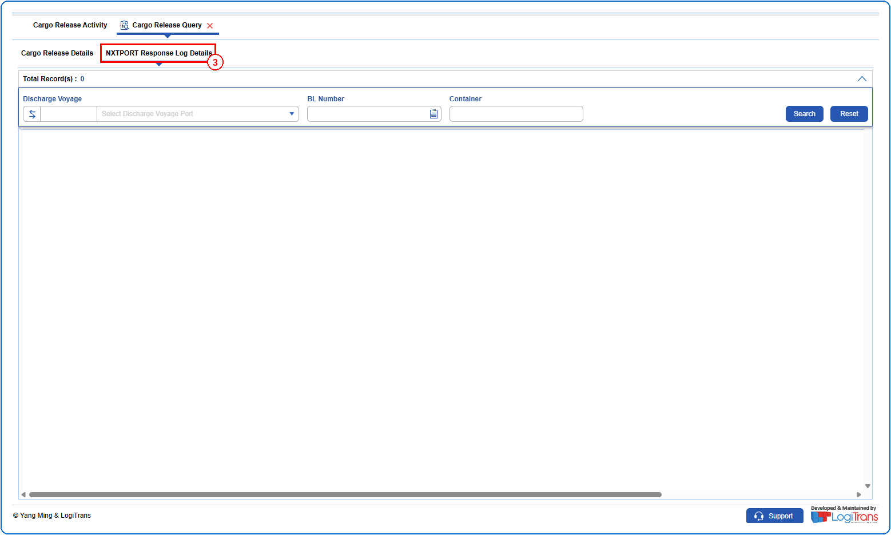
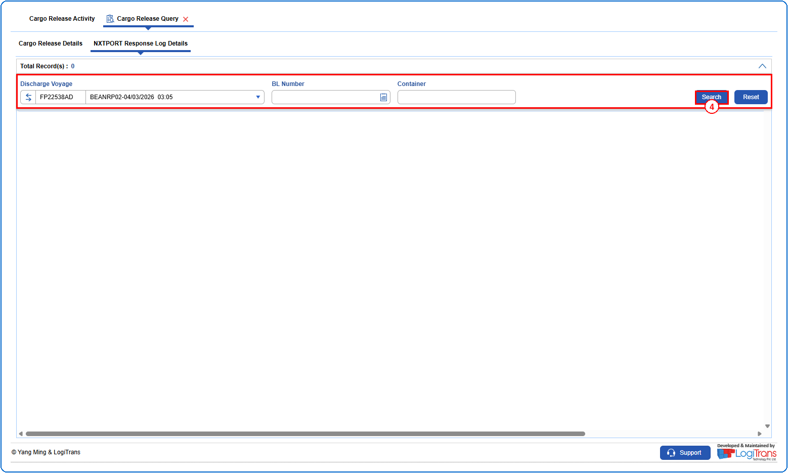
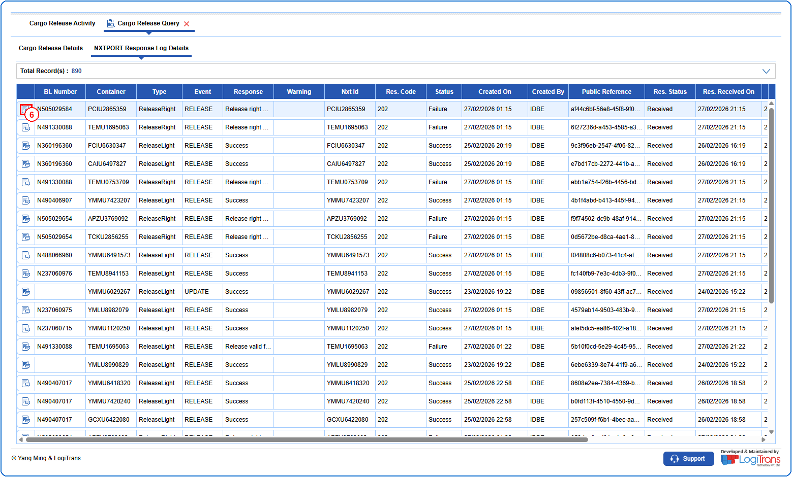
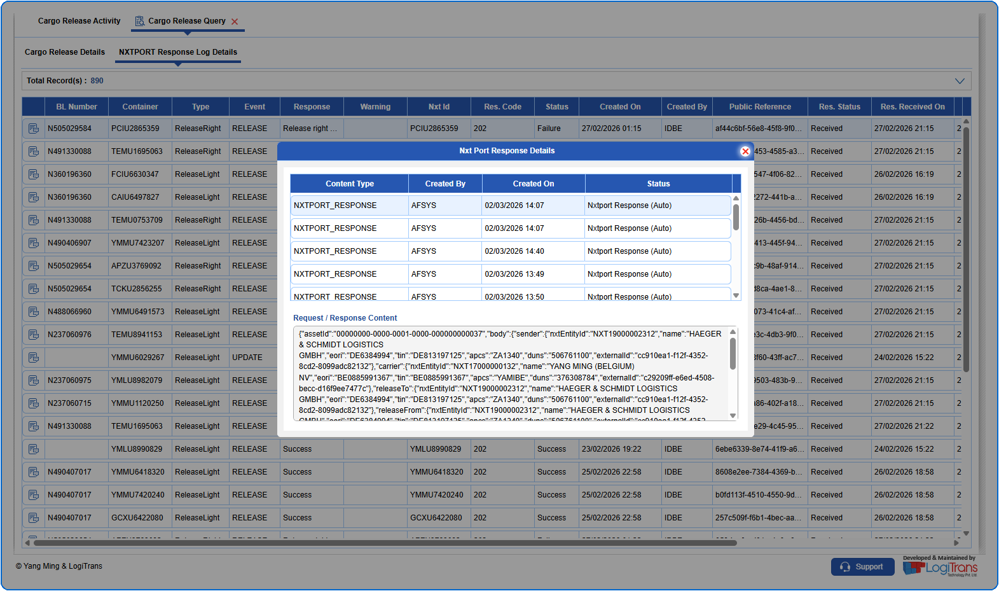

## Steps
**Step 1** : Click on {img:../img/scq_icon_side.png} from the side functions on the right side of the screen.

**Step 2** : Upon clicking {img:../img/scq_icon_side.png}, the user is shown Cargo Release Query screen.
**Step 3** : Click on {img:../img/scq_tab_nxtport.png} tab.

**Step 4** : Enter the query fields with desirable input for querying data and click on {img:../img/btn_search.png}.

**Step 5** : Upon clicking {img:../img/btn_search.png}, the NXTPORT response logs with matching information are returned.
**Step 6** : Click on {img:../img/scq_icon_api_log.png}(API Log Details icon) in the respective record.

**Step 7** : Upon clicking {img:../img/scq_icon_api_log.png}, the user is shown Nxt Port Response Details pop up screen with the request and response content.

