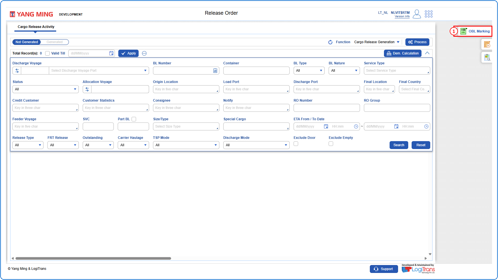
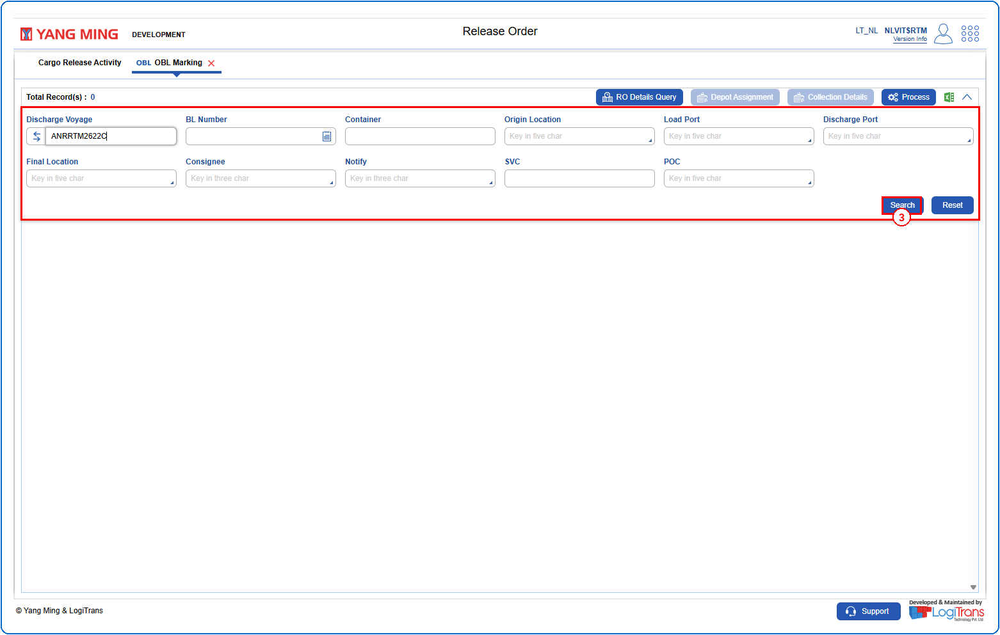
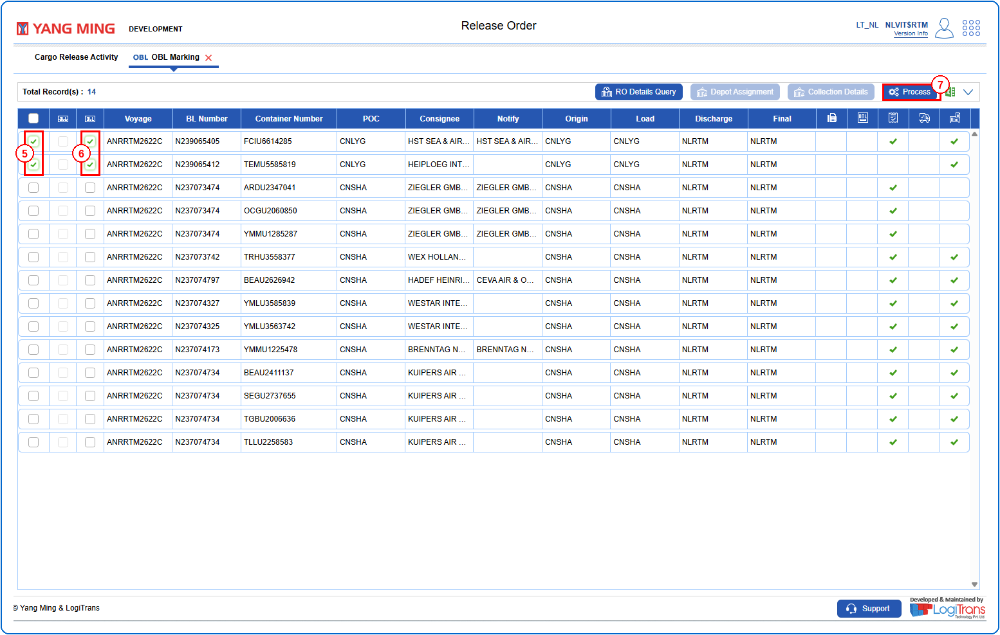
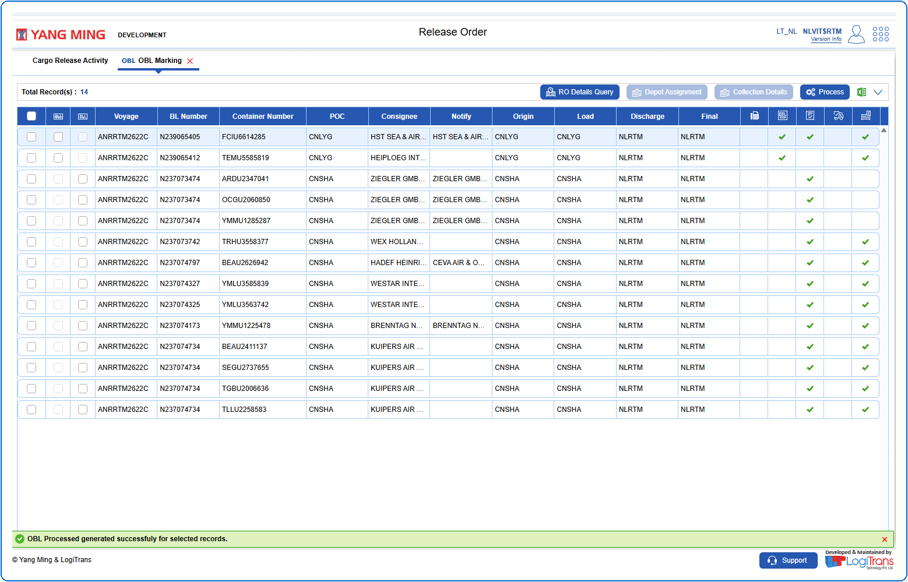

## Steps
**Step 1** : Click on {img:../img/obl_icon_side.png} from the side functions on the right side of the screen.

**Step 2** : Upon clicking {img:../img/obl_icon_side.png}, the user is shown OBL Marking screen.
**Step 3** : Enter the query fields with desirable input for querying data and click on {img:../img/btn_search.png}.

**Step 4** : Upon clicking {img:../img/btn_search.png}, BLs with matching information are returned.
**Step 5** : Select the checkbox {img:../img/cb_single_select.png} of the record(s).
**Step 6** : Select the checkbox {img:../img/cb_single_select.png} under the {img:../img/obl_icon_col.png} (OBL) column of the respective record(s).
**Step 7** : Click on {img:../img/obl_btn_process.png}.

If successfully processed, a success message is shown as given below.

