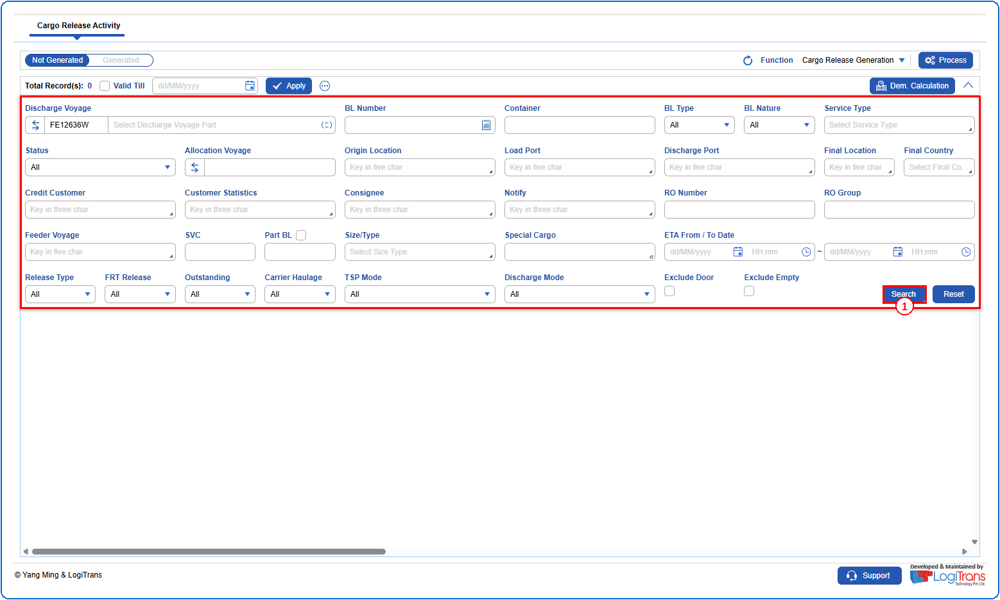
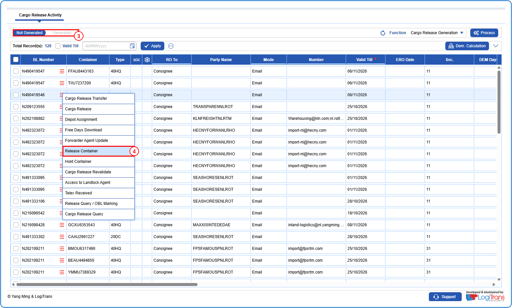
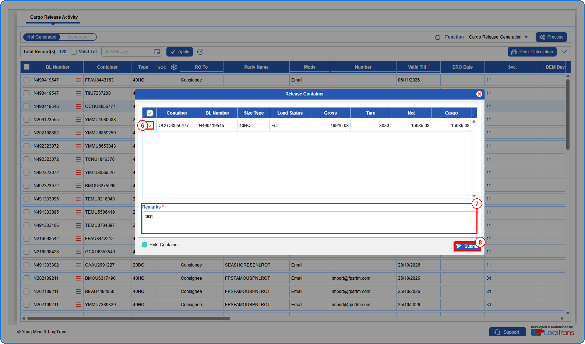
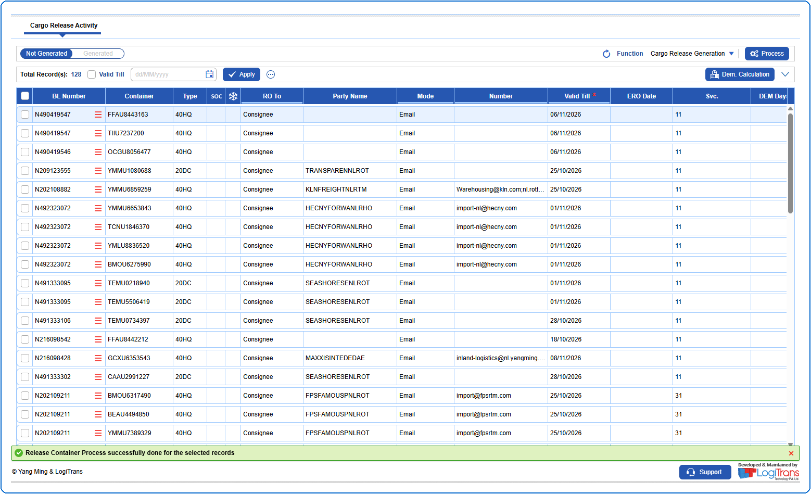

## Pre defined conditions
The container(s) should be on hold.

## Steps
**Step 1** : Enter the query fields with desirable input for querying data and click on {img:../img/btn_search.png}.

**Step 2** : Upon clicking {img:../img/btn_search.png}, BLs with matching information are returned.
**Step 3** : Click on "**Not Generated**" in the toggle to view the BLs that do not have existing Release Orders.
**Step 4** : The user should drag the cursor to the record menu icon {icon:record_menu} in the respective record, click on it, and then select "**Release Container**" from the menu.

**Step 5** : Upon clicking "**Release Container**", the user is shown Release Container pop up screen with the on-hold containers of the BL.
**Step 6** : Select the checkbox {img:../img/cb_single_select.png} of the container(s) to be released.
**Step 7** : Enter the reason for releasing the container(s) in the **Remarks** field.
**Step 8** : Click on {img:../img/rc_btn_submit.png}.

If successfully processed, a success message is shown as given below.

