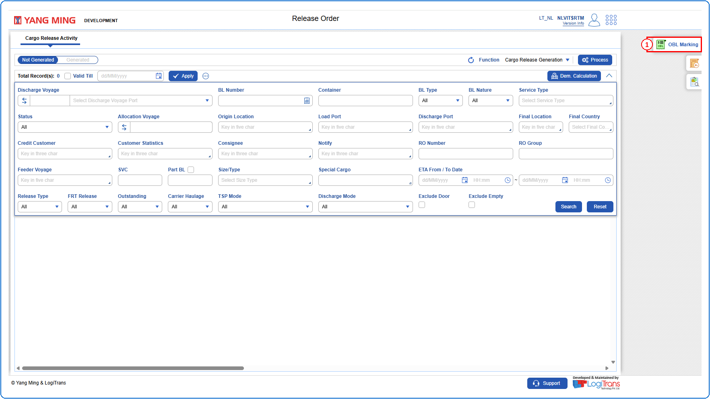
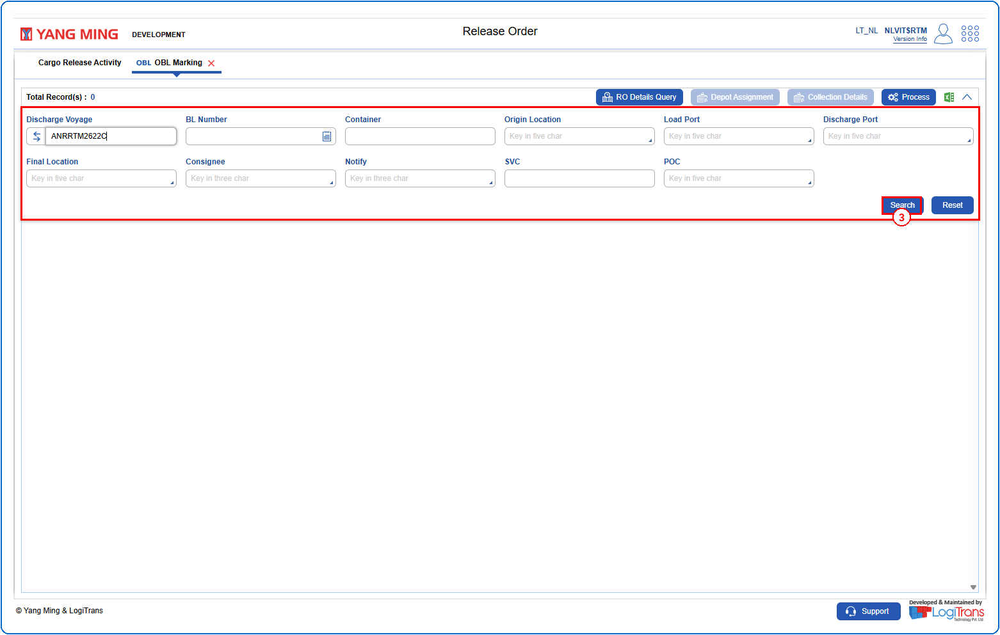
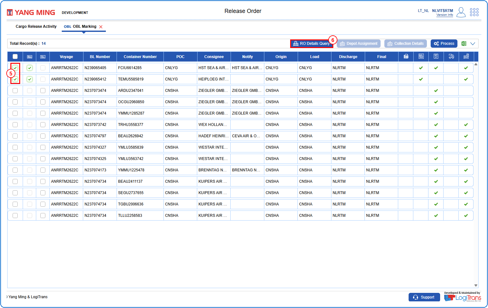
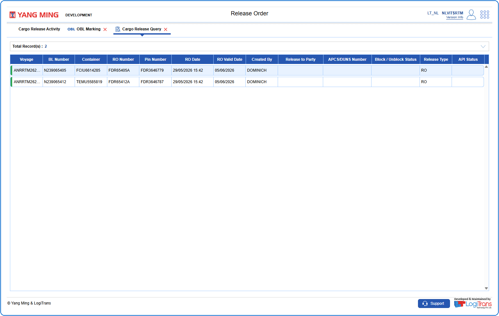

## Steps
**Step 1** : Click on {img:../img/obl_icon_side.png} from the side functions on the right side of the screen.

**Step 2** : Upon clicking {img:../img/obl_icon_side.png}, the user is shown OBL Marking screen.
**Step 3** : Enter the query fields with desirable input for querying data and click on {img:../img/btn_search.png}.

**Step 4** : Upon clicking {img:../img/btn_search.png}, BLs with matching information are returned.
**Step 5** : Select the checkbox {img:../img/cb_single_select.png} of the record(s).
**Step 6** : Click on {img:../img/obl_btn_ro_details.png}.

**Step 7** : Upon clicking {img:../img/obl_btn_ro_details.png}, the user is shown Cargo Release Query screen with the Release Order details of the selected record(s).

