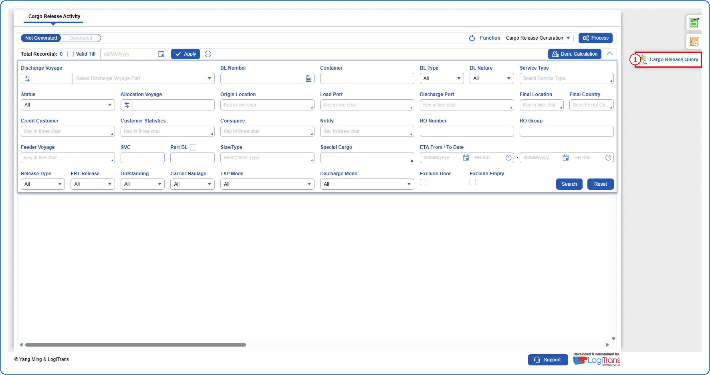
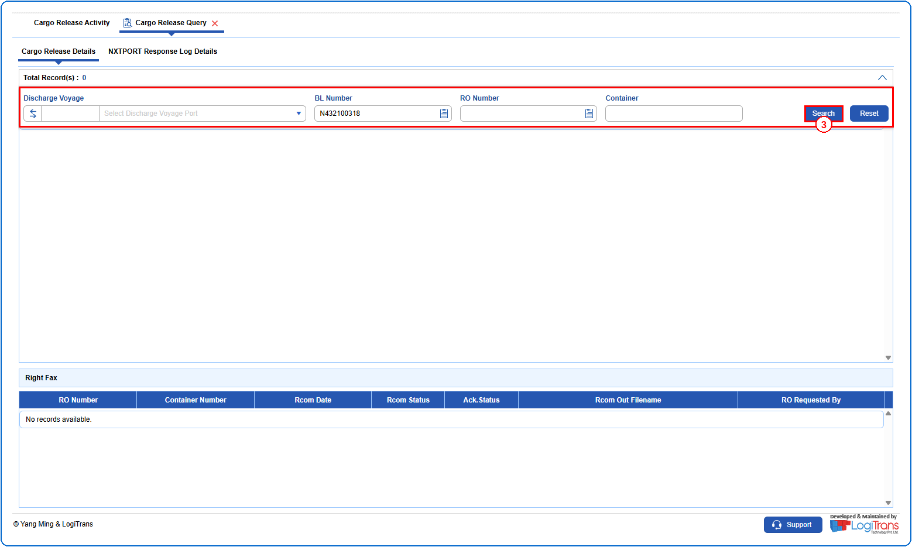
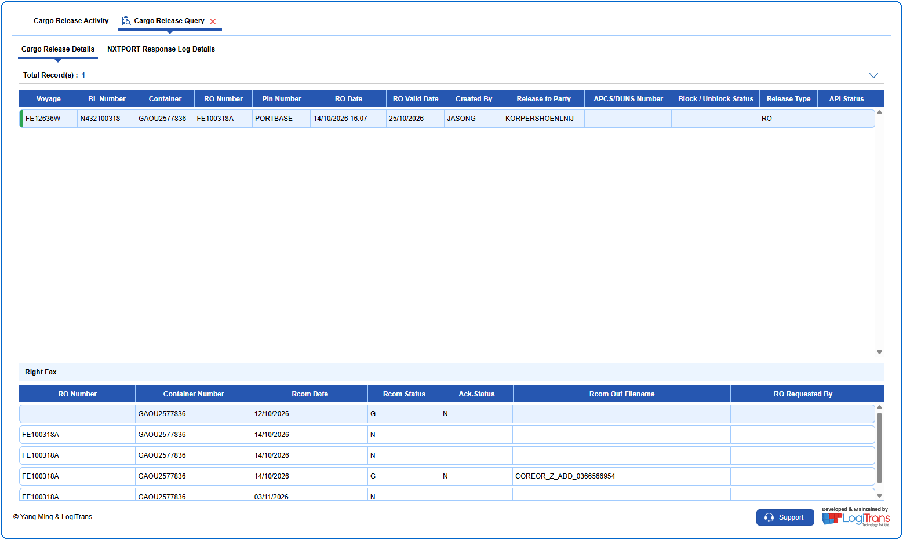

## Steps
**Step 1** : Click on {img:../img/scq_icon_side.png} from the side functions on the right side of the screen.

**Step 2** : Upon clicking {img:../img/scq_icon_side.png}, the user is shown Cargo Release Query screen with the Cargo Release Details tab.
**Step 3** : Enter the query fields with desirable input for querying data and click on {img:../img/btn_search.png}.

**Step 4** : Upon clicking {img:../img/btn_search.png}, the Release Order details with matching information are returned.

